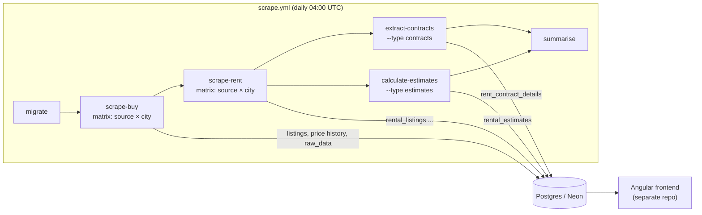

# Architecture

## Pipeline overview



## CLI — `main.py`

| `--type` | Function | What it does |
|---|---|---|
| `buy` (default) | `scrape_city()` | Runs the buy scraper, then `upsert_listings` + `deactivate_missing(city=…)` |
| `rent` | `scrape_city()` | Runs the rental scraper, then `upsert_rental_listings` + `deactivate_missing_rentals(city=…)` |
| `estimates` | `run_refresh_estimates()` | Bulk-recomputes `rental_estimates` (optionally scoped by `--city`) |
| `contracts` | `run_extract_contracts()` | Re-fetches descriptions of rented buy listings and extracts rent/expiry |

Other flags: `--source imovirtual|era` (default `imovirtual`), `--city <one of SUPPORTED_CITIES>` (omit for all), and
`--parallel` (one `ThreadPoolExecutor` worker per city; errors are logged, not raised).
Every run writes a `stats-<type>-…json` file to the CWD. The CI `summarise` job turns these into the job summary.

`SCRAPERS` maps `source → {"buy": cls, "rent": cls}`. For `ImovirtualBuyScraper` only, `scrape_city` preloads
`known_rented_ids` (via `get_rented_listing_ids(db, city, source)`) before `run()`.

## Scraper abstraction — `scraper/base.py`

```python
class Scraper(ABC):
    def fetch(self) -> list[dict]      # raw API pages
    def parse(self, responses) -> list[dict]   # normalised listing dicts (dedup by id)
    def enrich(self, listings) -> list[dict]   # optional: detail fetches (default no-op)
    def run(self): return self.enrich(self.parse(self.fetch()))
```

Each source has `<Source>BaseScraper(city)` plus `Buy`/`Rental` subclasses that set `MIN_PRICE`/`MAX_PRICE` from
`config.py` (and `CITY_PATHS` or `BUSINESS_TYPE_ID`). Rental subclasses never enrich. See [SCRAPERS.md](SCRAPERS.md).

### Normalised listing dict (parser output = DB row input)

`id, source, url, title, description, price, area, price_per_m2, rent_price_per_m2, location, neighborhood, city,
property_type, typology, floor, has_garage, is_rented, lifetime_rent, active=True, inactive_since=None, last_seen,
updated_at, _raw_json`

`_upsert` drops any key that isn't a column of the target model. That's why `rent_price_per_m2` is silently ignored for
`listings`, and why `lifetime_rent`/`is_rented` are ignored for `rental_listings`. `_raw_json` goes to `raw_data` / `rental_raw_data`.

## Repository layer — `db/repository.py`

### `_upsert(db, listings, model, price_history_model, raw_data_model) -> n_price_changes`
1. Sanitise URL (`/hpr/` → `/`) and run `normalize_location(neighborhood, city)`.
2. Load existing `{id: price, is_deleted, active}`.
3. Record a price change when the row exists, isn't deleted, and the price differs. Log reactivations.
4. `INSERT … ON CONFLICT (id) DO UPDATE SET <all cols except first_seen, created_at, is_deleted, id, source>
   WHERE is_deleted = false`, in chunks of 500.
5. Insert price-history rows, then upsert raw JSON (skipping deleted rows), then commit.

### `_deactivate_missing(db, source, active_ids, model, city)`
`UPDATE … SET active=false, inactive_since=NOW() WHERE source=:source AND active AND NOT is_deleted AND id != ALL(:ids) [AND city=:city]`

> [!WARNING]
> If a fetch fails and returns `[]`, every listing for that source/city is deactivated. The next good run reactivates them,
> but `inactive_since` will have flickered.

## Rental estimates

Uses comparable **active** rentals with `rent_price_per_m2`, for **active, non-deleted** buy listings that have `area` and `typology`.
`MIN_SAMPLES = 3`, `AREA_TOLERANCE = ±15%`. The first tier with ≥3 samples wins:

| Tier | Match | `confidence` | `match_level` |
|---|---|---|---|
| 1 | typology + neighborhood + area ±15% | high | neighborhood |
| 2 | typology + city + area ±15% | medium | city |
| 3 | typology + neighborhood | medium | neighborhood_broad |
| 4 | typology + city | low | city_broad |
| — | none | none | none |

`estimated_rent = round(avg_rent_per_m2 * area)`, `rental_yield = estimated_rent * 12 / price` (gross, as a fraction).

- `refresh_rental_estimates()` (used by the CLI) runs all four tiers in **one CTE query** (`_BULK_ESTIMATE_SQL`), with a `COALESCE`
  across tiers.
- `compute_rental_estimate()` / `compute_and_upsert_rental_estimates()` are the per-listing equivalent (used in tests).
  If you change tier logic, update **both**.
- Comparables are **not** filtered by source, so ERA and Imovirtual rentals are pooled.

## Rented detection & contract extraction

- `is_rented(text)`: case-insensitive substring match against `config.RENTED_KEYWORDS` (`arrendado`, `inquilino`,
  `arrendamento`, `renda`, `rented`, `tenant`, `alugado`, `contrato de aluguer`). It's deliberately broad, so expect false positives.
- `is_lifetime_rent(text)`: accent-stripped search for `vitalicio`/`vitalicia`.
- `scraper/contract_extractor.extract_rent_and_expiry(text)` (deterministic, PT + EN):
  - Strips HTML, then scores each euro amount: +0.5 for monthly wording nearby, +0.4 for a rent anchor (`renda atual`,
    `arrendado por`, `monthly rent`, …) within ±80 chars, and +0.1 if it falls in €50–10,000 (anything outside that range scores 0).
    Per-m² prices and condominium fees score 0. Multi-unit text ("duas casas … cada uma") multiplies the amount.
  - Expiry: anchor phrases (`contrato válido até`, `until`, …) → `dateparser`. A bare month+year resolves to the last day of the
    month.
  - Returns `{current_rent_amount, currency, contract_expiry_date (ISO), raw_rent_text, raw_expiry_text, confidence}`.
- `run_extract_contracts()` loads active rented buy listings (all sources), gets an Imovirtual `buildId`, and calls the
  Imovirtual `_fetch_detail` for each URL. When there's no detail, it falls back to title + stored description. Only rows that
  have a rent or an expiry are upserted.

> [!NOTE]
> ERA listings go through `_fetch_detail` too. The call fails for era.pt URLs, so ERA contract extraction relies on the
> description that `ERABuyScraper.enrich` already stored. The `cities_needed` loop just collects every city in
> `BUY_CITY_PATHS` (or the single `--city`). Only the first `buildId` is used.

## Configuration — `config.py`

| Name | Value |
|---|---|
| `MIN_PRICE` / `MAX_PRICE` | 50,000 / 405,000 (buy) |
| `MIN_RENTAL_PRICE` / `MAX_RENTAL_PRICE` | 300 / 4,000 |
| `REQUEST_DELAY` | 2 s between HTTP requests |
| `SUPPORTED_CITIES` | Porto, Matosinhos, Vila Nova de Gaia, Maia, Paços de Ferreira, Penafiel, Paredes, Ermesinde, Alfena |
| `PARISH_CITIES` | {Ermesinde, Alfena}: freguesias of Valongo stored as their own `city` |
| `RENTED_KEYWORDS` | see above |

## Neighborhood normalization — `normalization.py`

`normalize_location(neighborhood, city) -> (neighborhood, city)`:
1. Generic or non-freguesia names (`"Centro"`, `"Porto"`, `"Rio Tinto"`, codes like `"A1 - …"`) → `(city, city)`.
2. Case-insensitive alias lookup → canonical freguesia. Merged parishes (uniões de freguesias) use the official union
   name, e.g. `"Cedofeita, Santo Ildefonso, Sé, Miragaia, São Nicolau e Vitória"`.
3. `_NEIGHBORHOOD_CITY` corrects the city when a parish belongs to another municipality.
4. Missing neighborhood → the city name.

Good normalization matters because rental-estimate tiers 1 and 3 join on exact `neighborhood` equality.
