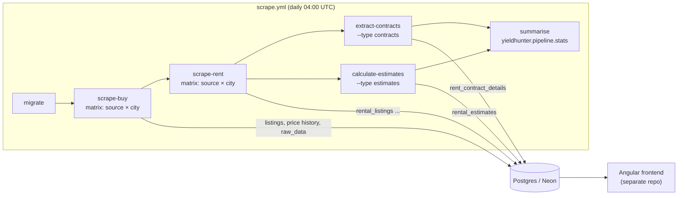

# Architecture

## Pipeline overview



## Package layout — `yieldhunter/`

- **`yieldhunter/cli.py`** (+ root `main.py` shim): CLI parser & dispatcher.
- **`yieldhunter/config.py`**: price bounds, `REQUEST_DELAY`, `SUPPORTED_CITIES`, `PARISH_CITIES`, `RENTED_KEYWORDS`,
  `ESTIMATE_MIN_SAMPLES`, `ESTIMATE_AREA_TOLERANCE`, `INSERT_CHUNK_SIZE`.
- **`yieldhunter/db/`**:
  - `session.py`: lazy engine initialization (`get_engine()`), `session_scope()` context manager, `configure_session()` for tests.
  - `models.py`: SQLAlchemy declarative models (100% parity with Alembic `0001`–`0029`).
  - `repository/`: split by domain (`common.py`, `listings.py`, `estimates.py`, `contracts.py`).
- **`yieldhunter/analysis/`**: pure text/data logic (`normalization.py`, `rented.py`, `typology.py`, `contracts.py`).
- **`yieldhunter/sources/`**: `Scraper` ABC + `ScrapeResult(listings, complete)`, shared HTTP headers (`http.py`),
  `registry.py`, and source packages `imovirtual/` and `era/`.
- **`yieldhunter/pipeline/`**: high-level workflow steps (`scrape.py`, `estimates.py`, `contracts.py`, `stats.py`).

## CLI — `yieldhunter/cli.py`

| `--type` | Function | What it does |
|---|---|---|
| `buy` (default) | `scrape_city()` | Runs buy scraper -> `upsert_listings` + `deactivate_missing(city=…)` (if `result.complete`) |
| `rent` | `scrape_city()` | Runs rental scraper -> `upsert_rental_listings` + `deactivate_missing_rentals(city=…)` (if `result.complete`) |
| `estimates` | `run_refresh_estimates()` | Bulk-recomputes `rental_estimates` (optionally scoped by `--city`) |
| `contracts` | `run_extract_contracts()` | Extracts rent & contract expiry from stored descriptions of active tenanted buy listings |
| `summarize` | `stats.main()` | Renders Markdown summary tables from `stats-*.json` in `--stats-dir` (stdlib-only) |

Other flags: `--source imovirtual|era`, `--city <one of SUPPORTED_CITIES>`, `--parallel` (one thread per city).

## Scraper abstraction — `yieldhunter/sources/base.py`

```python
@dataclass(frozen=True)
class ScrapeResult:
    listings: list[dict]
    complete: bool = True

class Scraper(ABC):
    def fetch(self) -> list[dict]
    def parse(self, responses: list[dict]) -> list[dict]
    def enrich(self, listings: list[dict]) -> list[dict]
    def run(self) -> list[dict]
    def run_checked(self) -> ScrapeResult
```

Each source reuses the HTTP session and `buildId`/CSRF token obtained during `fetch()` inside `enrich()`, avoiding a
duplicate search-page HTML round-trip. If token/buildId extraction fails or a search page returns non-200 mid-pagination,
`last_fetch_complete` is set to `False` so `scrape_city()` upserts any valid pages already collected **without**
deactivating existing listings.

## Repository layer — `yieldhunter/db/repository/`

### `listings.py`
- **`_upsert`**: sanitizes URL (`/hpr/` → `/`), normalizes `(neighborhood, city)` via `normalize_location`, compares
  prices against existing non-deleted rows to record `price_changes` and log reactivations, upserts in chunks of 500 with
  `WHERE is_deleted = false`, inserts price history, and upserts `raw_data` (skipping deleted rows).
- **`_deactivate_missing`**: `UPDATE … SET active=false, inactive_since=NOW() WHERE source=:source AND active AND NOT is_deleted AND id != ALL(:ids) [AND city=:city]`.

### `estimates.py` — Size-curved weighted-median comparables (`area^0.30` + 60-day recency)
Rent per m² is strongly non-linear with apartment size (`rent ∝ area^0.30` within the same parish and typology).
Both `refresh_rental_estimates(db, city=...)` and `compute_rental_estimate(db, listing_id)` /
`compute_and_upsert_rental_estimates(db, listing_ids)` use the same estimator:

1. **Comparable pool:** active rentals plus rentals deactivated within the last `ESTIMATE_INACTIVE_DAYS` (60 days,
   weighted at `0.60×` vs `1.0×` for active), pooling ERA and Imovirtual together.
2. **Location priority (`MIN_SAMPLES = 3`):**
   - `≥3` comps in `(city, neighborhood, typology)` → stays in the parish (`high` / `neighborhood` when `≥3` are within
     `±15%` area, otherwise `medium` / `neighborhood_broad`).
   - Otherwise `≥3` comps in `(city, typology)` → city pool (`medium` / `city` when `≥3` are within `±15%` area,
     otherwise `low` / `city_broad`).
   - Otherwise → `none`.
3. **Curve adjustment & weighted median:** each comparable's rent is size-adjusted via
   `comp_rent × (target_area / comp_area)^0.30` and aggregated via **weighted median** (weighted by parish match,
   Gaussian log-area similarity `σ = 0.22`, and recency) so luxury outliers cannot skew yields.
4. `avg_rent_per_m2 = round(raw_est_rent / area, 2)`, `rental_yield = round(estimated_rent * 12 / price, 4)`.

### `contracts.py` & `pipeline/contracts.py` — DB-first contract extraction
`get_rented_listings_for_extraction` outer-joins `listings` with `raw_data` to retrieve `title`, `description`, and
`raw_json['fullDescription']` in a single query. Because `ImovirtualBuyScraper.enrich` and `ERABuyScraper.enrich`
already refresh full descriptions for all active rented listings on every buy run, `run_extract_contracts` extracts rent
and expiry with **zero HTTP requests** (falling back to an Imovirtual detail request only if an older Imovirtual row
lacks `fullDescription` in `raw_data`).
