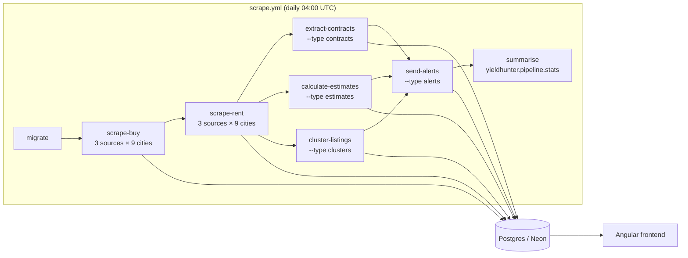

# Architecture

## Pipeline overview

## CLI modes (`yieldhunter/cli.py`)

| `--type` | Entrypoint | Description |
|---|---|---|
| `buy` / `rent` | `scrape_city` / `scrape_all` | Scrapes `imovirtual`, `era`, or `casasapo`; skips deactivation when `not result.complete` |
| `estimates` | `run_refresh_estimates` | Size-curved (`area^0.30`) weighted-median rent & yield + syncs contract reversion yields |
| `contracts` | `run_extract_contracts` | DB-first rent/expiry extraction + syncs `current_yield`, `reversion_yield`, `rent_upside_pct`, `months_to_expiry` |
| `clusters` | `run_refresh_clusters` | Union-find deduplication of physical apartments across sources/agencies (`listing_clusters`) |
| `alerts` | `run_send_alerts` | Matches new deals & price drops against `saved_searches.filters` and sends digests |
| `summarize` | `stats.main` | Stdlib-only Markdown summary generator for GitHub Actions |

## Key Domain Flows

### 1. Price-drop & Motivated-Seller Signals (`db/repository/listings.py`)
On initial insert, `initial_price = price`, `price_drop_amount = 0`, `price_drop_pct = 0`, `price_change_count = 0`.
Whenever `price` changes on a non-deleted row, `(previous_price, price)` is appended to `listing_price_history`,
`initial_price` remains untouched, and `price_drop_amount` (`initial_price - price`), `price_drop_pct`, and
`price_change_count` are updated inline.

### 2. Tenanted Lease-Expiry Upside (`db/repository/contracts.py`)
`sync_contract_upside_metrics()` joins `rent_contract_details` with `listings` and `rental_estimates` to populate:
- `current_yield = current_rent * 12 / price`
- `reversion_yield = estimated_rent * 12 / price`
- `rent_upside_pct = (estimated_rent - current_rent) / current_rent`
- `months_to_expiry` relative to UTC today.

### 3. Size-Curved Rental Estimates (`db/repository/estimates.py`)
Pools active rentals + rentals deactivated in the last 60 days (`0.6×` weight), stays in `(city, neighborhood, typology)`
when `≥3` comps exist before falling back to `(city, typology)`, adjusts each comp via
`comp_rent × (target_area / comp_area)^0.30`, and takes a Gaussian-area × recency × parish weighted median.

### 4. Physical-Apartment Clustering (`analysis/clustering.py`)
Within `(city, neighborhood, typology)`, merges pairs with `≤ max(2 m², 2%)` area difference, `≤ 12%` price spread, no
floor or street conflicts, and strong identity evidence (matching street name, `≥ 0.45` distinctive token Jaccard, or
cross-source exact area/floor/garage signature), enforcing cluster-wide invariants to prevent transitive drift.

### 5. Saved-Search Deal Alerts (`analysis/alerts.py`, `pipeline/alerts.py`)
Evaluates active buy listings that are newly seen (`first_seen > last_checked_at`) or had a price cut
(`listing_price_history.captured_at > last_checked_at AND price < previous_price`), matches camelCase/snake_case filter
keys in `saved_searches.filters`, deduplicates via `alert_notifications(saved_search_id, listing_id, triggered_price)`,
and delivers via Telegram, Resend, and/or Webhook.
