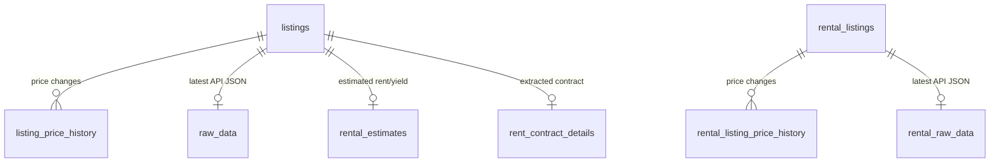

# Data model

PostgreSQL (Neon in prod). ORM models live in `yieldhunter/db/models.py` and are kept in 100% parity with Alembic
migrations in `migrations/versions/` (current head: **0029**).



## Scraper-owned tables

### `listings` (`Listing`) / `rental_listings` (`RentalListing`)
PK `id` (text). Shared columns:

| Column | Notes |
|---|---|
| `id`, `source`, `url` | `source` ∈ `imovirtual`, `era`. ERA ids are prefixed `era-` |
| `title`, `description` | `description` holds full text after buy enrichment |
| `price` (int), `area` (int m²), `price_per_m2` (float) | buy: EUR; rent: EUR/month |
| `location`, `neighborhood`, `city` | normalized at upsert (`yieldhunter/analysis/normalization.py`) |
| `property_type`, `typology` (`T0`…), `floor` (text), `has_garage` | |
| `active`, `inactive_since` | managed by `_deactivate_missing` (when scrape is complete) / reactivation on upsert |
| `is_deleted` | set by the frontend. **Rows with `is_deleted = true` are never updated by scrapes** |
| `first_seen`, `created_at` | never overwritten on upsert |
| `last_seen`, `updated_at` | refreshed on every scrape |

Only on `listings`: `is_rented`, `lifetime_rent`. Only on `rental_listings`: `rent_price_per_m2`.

### `listing_price_history` / `rental_listing_price_history`
`id` serial, `listing_id` FK, `price`, `captured_at`. One row per detected price change (never for initial insert).

### `raw_data` / `rental_raw_data`
PK/FK `listing_id`, `raw_json` JSONB (Imovirtual buy items include `fullDescription`), `captured_at`.

### `rental_estimates` (`RentalEstimate`)
PK/FK `listing_id` → `listings.id ON DELETE CASCADE`. `estimated_rent` int, `avg_rent_per_m2` numeric(10,2),
`sample_count`, `confidence` (`high|medium|low|none`), `match_level`
(`neighborhood|city|neighborhood_broad|city_broad|none`), `rental_yield` numeric(8,4) (0.0612 = 6.12%), `computed_at`.

### `rent_contract_details` (`RentContractDetail`)
PK/FK `listing_id` → `listings.id ON DELETE CASCADE`. `current_rent` numeric(10,2), `contract_expiry_date` date,
`raw_rent_text`, `raw_expiry_text`, `confidence` numeric(3,2), `extracted_at`, `updated_at`.

## Frontend & archival tables (owned by the Angular app; models + migrations live here)

| Table | Model | Columns |
|---|---|---|
| `user_favorites` | `UserFavorite` | `(user_id, listing_id)` PK, `created_at` (no FK since 0016; covers buy + rent IDs) |
| `user_hidden` | `UserHidden` | `(user_id, listing_id)` PK, `created_at` |
| `audit_log` | `AuditLog` | `id` bigserial, `action`, `listing_id`, `user_id`, `user_email`, `created_at` |
| `saved_searches` | `SavedSearch` | `id` bigserial, `user_id` (indexed), `name`, `filters` JSONB, `last_checked_at`, `created_at` |
| `listing_snapshots` | `ListingSnapshot` | `listing_id` PK, `blob_url`, `created_at` |

`user_id` references `neon_auth.users.id` (enforced in frontend application code).

## Writing a migration

```python
# migrations/versions/0030_<slug>.py
revision: str = "0030"
down_revision: Optional[str] = "0029"
```
- Update `yieldhunter/db/models.py` alongside the migration so unit tests (`create_all`) and Alembic stay identical.
- Prefer idempotent SQL (`CREATE TABLE IF NOT EXISTS`) like 0028/0029, and always provide `downgrade()`.
