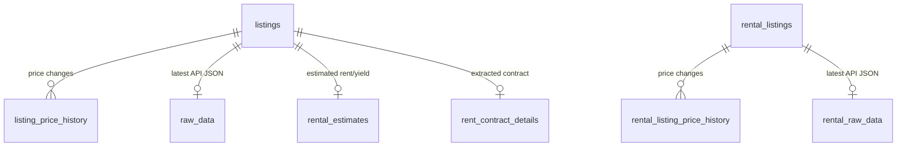

# Data model

PostgreSQL (Neon in prod). ORM models live in `db/models.py`. The schema is managed by Alembic in `migrations/versions/`
(current head: **0029**).



## Scraper-owned tables

### `listings` (buy) / `rental_listings` (rent)
PK `id` (text). Shared columns:

| Column | Notes |
|---|---|
| `id`, `source`, `url` | `source` ∈ `imovirtual`, `era`. ERA ids are prefixed `era-` |
| `title`, `description` | description = short or primary description (full text after enrich) |
| `price` (int), `area` (int m²), `price_per_m2` (float) | buy: EUR. rent: EUR/month |
| `location`, `neighborhood`, `city` | normalised at upsert (`normalization.py`) |
| `property_type`, `typology` (`T0`…), `floor` (text), `has_garage` | |
| `active`, `inactive_since` | managed by `_deactivate_missing` / reactivation on upsert |
| `is_deleted` | set by the frontend. **Rows with `is_deleted = true` are never updated by scrapes** |
| `first_seen`, `created_at` | never overwritten on upsert |
| `last_seen`, `updated_at` | set by the parser on every scrape |

Only on `listings`: `is_rented`, `lifetime_rent`. Only on `rental_listings`: `rent_price_per_m2`
(this is what estimates average over).

### `listing_price_history` / `rental_listing_price_history`
`id` serial, `listing_id` FK, `price`, `captured_at`. One row per detected change (never for the first sighting).

### `raw_data` / `rental_raw_data`
PK/FK `listing_id`, `raw_json` JSONB (latest item from the source API; Imovirtual buy items get `fullDescription` merged in),
`captured_at`.

### `rental_estimates`
PK/FK `listing_id` → `listings.id ON DELETE CASCADE`. `estimated_rent` int, `avg_rent_per_m2` numeric(10,2),
`sample_count`, `confidence` (`high|medium|low|none`), `match_level`
(`neighborhood|city|neighborhood_broad|city_broad|none`), `rental_yield` numeric(8,4) (0.0612 = 6.12%), `computed_at`.
Indexes on `rental_listings(typology, neighborhood, area)` and `(typology, city, area)` (0021).

### `rent_contract_details`
PK/FK `listing_id` → `listings.id ON DELETE CASCADE`. `current_rent` numeric(10,2), `contract_expiry_date` date,
`raw_rent_text`, `raw_expiry_text`, `confidence` numeric(3,2), `extracted_at`, `updated_at`.

## Frontend-owned tables (migrations live here, but nothing in this repo writes them)

| Table | Columns | Model? |
|---|---|---|
| `user_favorites` | `(user_id, listing_id)` PK, `created_at`. No FK to listings since 0016, so it covers buy + rent ids | **No model** |
| `user_hidden` | `(user_id, listing_id)` PK, `created_at` | `UserHidden` |
| `audit_log` | `id` bigserial, `action`, `listing_id`, `user_id`, `user_email`, `created_at` | `AuditLog` |
| `saved_searches` | `id` bigserial, `user_id` (indexed), `name`, `filters` JSONB, `last_checked_at`, `created_at` | `SavedSearch` |

`user_id` = `neon_auth.users.id`. There is no cross-schema FK; it's enforced in app code.

## Migration history (condensed)

| Rev | Change |
|---|---|
| 0001 | init: listings, price history, raw_data |
| 0002–0005 | `lifetime_rent`; `active`/`inactive_since`; dropped unused columns and `condition` |
| 0006–0009 | `is_favorite` → `is_deleted`; user/favorites experiments (later dropped) |
| 0010 | `neighborhood`, `city` |
| 0011 / 0016 | `user_favorites` created; FK to listings dropped |
| 0012–0013 | dropped `raw_html`; `listing_snapshots` |
| 0014–0015 | rental tables |
| 0017–0019 | `user_roles` (created then dropped); `user_hidden` |
| 0020–0023 | `rental_estimates` + indexes + `rental_yield` (widened in 0023) |
| 0024 | `rent_contract_details` |
| 0025–0027 | **data** migrations: remap neighborhoods to canonical freguesias; generic → city name |
| 0028 | `audit_log` |
| 0029 | `saved_searches` |

> [!NOTE]
> `listing_snapshots` (created in 0013, never dropped) still exists in the DB but has **no model** and nothing writes it.
> The same goes for `user_favorites`. Neither table is in the test schema (`create_all`).

## Writing a migration

```python
# migrations/versions/0030_<slug>.py
revision: str = "0030"
down_revision: Optional[str] = "0029"
```
- Add or adjust the model in `db/models.py` too: tests use `create_all`, not Alembic.
- Prefer raw idempotent SQL (`CREATE TABLE IF NOT EXISTS`) like 0028/0029, and always write a `downgrade()`.
- The daily `scrape.yml` runs `alembic upgrade head` first, so a pushed migration hits prod on the next run (or on a manual
  `migrate.yml` dispatch).
