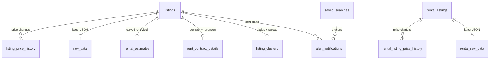

# Data model

PostgreSQL (Neon in prod). ORM models live in `yieldhunter/db/models.py` in 100% parity with Alembic migrations
`0001`–`0030`.

## Tables

### `listings` (`Listing`) & `rental_listings` (`RentalListing`)
- Identity & URL: `id` PK (`<num>`, `era-<Ref>`, `casasapo-<UUID>`), `source`, `url`.
- Pricing & motivated-seller signals: `price`, `initial_price` (immutable first-seen price), `price_drop_amount`
  (`initial_price - price`), `price_drop_pct`, `price_change_count`, `area`, `price_per_m2` (+ `rent_price_per_m2` on rentals).
- Location & attributes: `location`, `neighborhood`, `city`, `property_type`, `typology`, `floor`, `has_garage`.
- Status: `active`, `inactive_since`, `is_deleted` (sacred frontend flag), `first_seen`, `last_seen`, `created_at`, `updated_at`.
- Buy-only flags: `is_rented`, `lifetime_rent`.

### `listing_price_history` & `rental_listing_price_history`
`id` serial, `listing_id` FK, `previous_price` (price prior to change), `price` (new price), `captured_at`.

### `rental_estimates` (`RentalEstimate`)
`listing_id` PK/FK, `estimated_rent`, `avg_rent_per_m2`, `sample_count`, `confidence`, `match_level`, `rental_yield`, `computed_at`.

### `rent_contract_details` (`RentContractDetail`)
`listing_id` PK/FK, `current_rent`, `contract_expiry_date`, `raw_rent_text`, `raw_expiry_text`, `confidence`, plus
lease-upside columns: `current_yield` (`current_rent * 12 / price`), `reversion_yield` (`estimated_rent * 12 / price`),
`rent_upside_pct` (`(estimated_rent - current_rent) / current_rent`), and `months_to_expiry`.

### `listing_clusters` (`ListingCluster`)
`listing_id` PK/FK, `cluster_id` (indexed), `cluster_size`, `cluster_min_price`, `cluster_max_price`, `price_spread`,
`price_spread_pct`, `is_cheapest`, `sources` (JSONB list of sources), `computed_at`.

### `saved_searches` (`SavedSearch`) & `alert_notifications` (`AlertNotification`)
- `saved_searches`: `id` bigserial, `user_id`, `name`, `filters` JSONB, `last_checked_at`, `created_at`.
- `alert_notifications`: `(saved_search_id, listing_id, triggered_price)` PK, `trigger_type` (`new` | `price_drop`), `sent_at`.

### Frontend & archival tables
`user_favorites` (`UserFavorite`), `user_hidden` (`UserHidden`), `audit_log` (`AuditLog`), `listing_snapshots` (`ListingSnapshot`).
